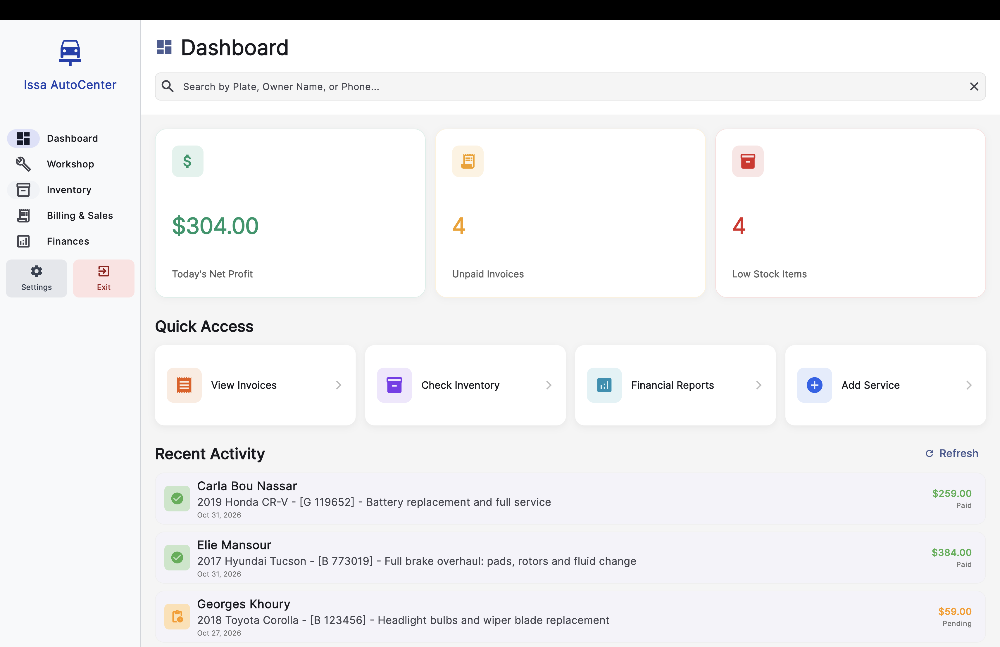
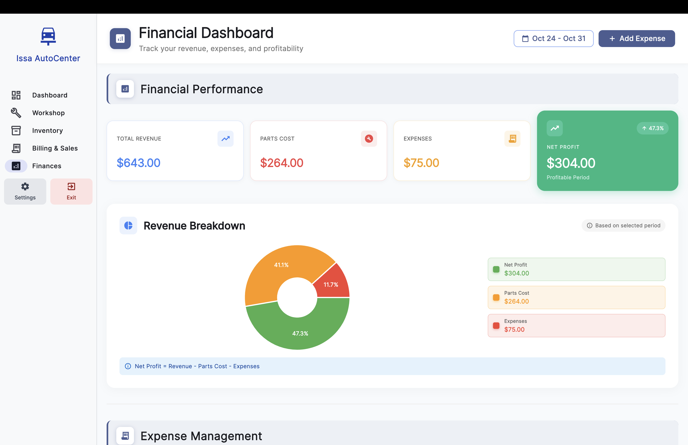
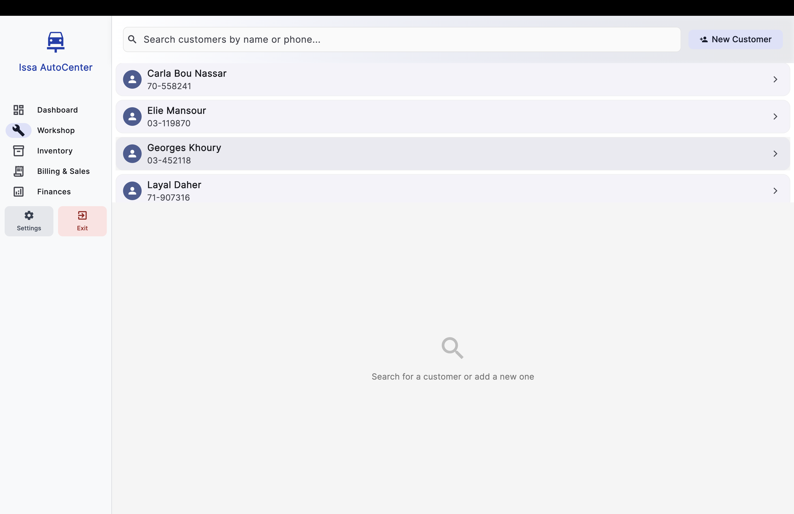
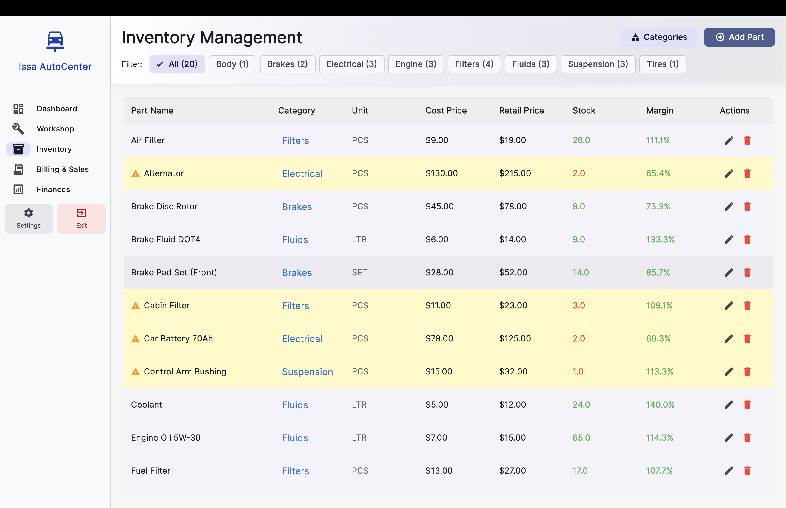
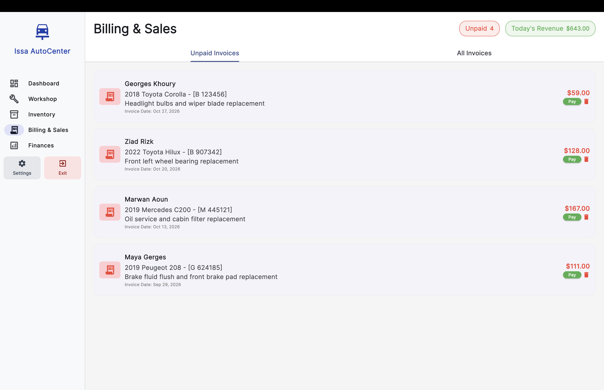
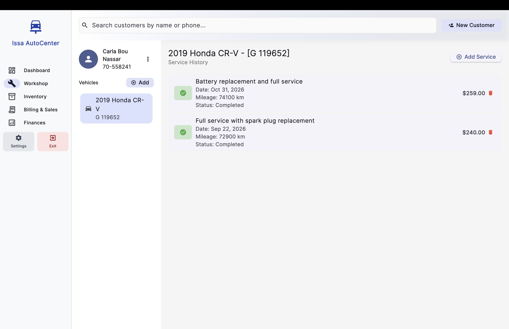

# GarageFlow 🚗 - Auto Repair POS System

A freelance desktop Point of Sale (POS) and shop management system developed for local automotive repair centers. 

Designed as an offline-first desktop application to eliminate recurring server and hosting costs for the client, while ensuring seamless daily operations.

### 📸 Screenshots

**Dashboard & Financial Overview**

**Workshop & Inventory**

**Invoices & Customer Details**

### 🛠️ Tech Stack
* **Front-End / Desktop Client:** Flutter
* **Back-End / API:** Node.js, Express.js
* **Database & Storage:** PostgreSQL, Local Storage

### 🚀 Key Features
* **Offline-First Architecture:** Ensures uninterrupted service by storing data locally, eliminating dependency on constant internet access and costly cloud hosting.
* **Service & Customer Tracking:** Manages comprehensive service histories and customer records for streamlined vehicle maintenance.
* **Inventory Management:** Tracks spare parts and shop supplies in real-time.
* **Financial Reporting:** Maintains accurate financial ledgers, tracking income, expenses, and overall shop profitability.
